<p align="center">
  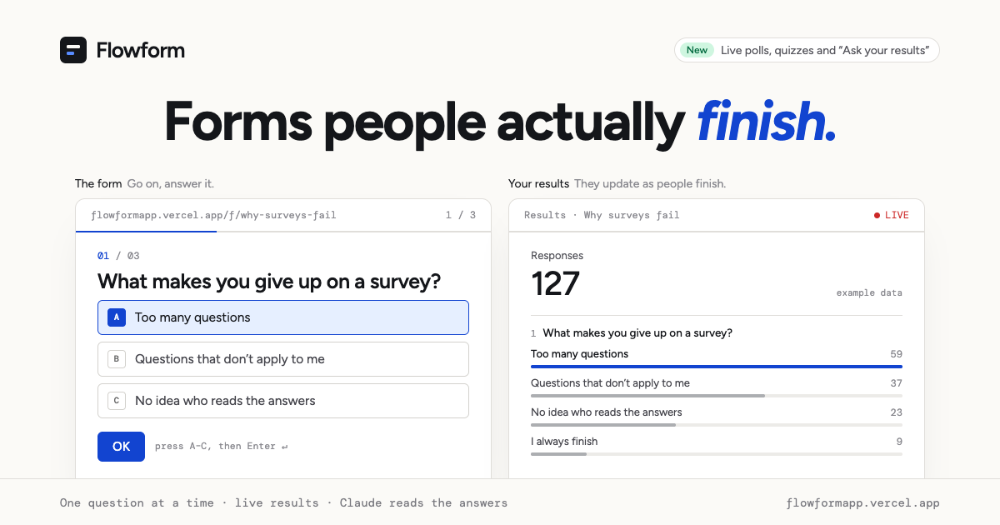
</p>

<p align="center">
  <a href="https://flowformapp.vercel.app"><b>Live app →</b></a>
  ·
  <a href="https://flowformapp.vercel.app/explore">Explore the app (no sign-up)</a>
  ·
  <a href="#features">Features</a>
  ·
  <a href="#design">Design</a>
  ·
  <a href="#how-its-built">How it's built</a>
  ·
  <a href="#run-it-yourself">Run it yourself</a>
</p>

<p align="center">
  
  
  
  
  
  
  
  <a href="https://github.com/andriuskleinas/flowform/actions/workflows/ci.yml"></a>
  
</p>

# Flowform

**Forms people actually finish.** A full-stack form builder in the spirit of Typeform: respondents
answer one question at a time, like a conversation, which is why they get to the end. Claude helps
you write the questions and reads the open-text answers for you, and a real conversion funnel shows
exactly where people drop off.

It's a deployed product, built end to end: product design, database security, AI integration,
analytics and auth.

No account needed: [open the demo workspace](https://flowformapp.vercel.app/explore) to click
through the signed-in app (dashboard, editor, results, live view) with example data, or
[answer a sample form](https://flowformapp.vercel.app/demo). The demo workspace runs entirely in
your browser, so nothing you change reaches the database.

> Portfolio project. The product works end to end; the example numbers in the landing page's
> product mock-ups are labelled as illustrative.

## Features

**Build**

| Feature | What it does |
|---|---|
| **Question builder** | 7 question types: short and long text, single or multi choice, dropdown, Yes / No, NPS and rating scales. Drag to reorder, start from a template or a blank form, and preview exactly what respondents see. |
| **Drafted by Claude** | Give the form a title and goal and Claude (Sonnet 5.5) drafts five to eight questions, each with the right type and options. Add the ones you want with one click. |
| **Logic jumps** | Forward-only rules ("if they answer X, skip to…") in both one-at-a-time and one-page forms. A required question someone never sees can't block them. |
| **Answer recall** | Name an answer and reuse it later: "Thanks, {name}. What should we fix first?" Hidden fields from the link work the same way. |
| **Follow-up questions by Claude** | When a written answer is short or vague, Claude asks one optional follow-up before moving on. Rate-limited server-side. |
| **Quiz mode** | Points per choice, a score at the end, and outcomes matched to score ranges. |
| **Branding** | Per-form accent colour, font and cover image; a custom thank-you message or a redirect after submit. |

**Share**

| Feature | What it does |
|---|---|
| **Conversational or classic** | One question at a time with a progress bar and keyboard shortcuts (Enter, A–Z, Y/N, 0–9), or every question on one page. |
| **Link, QR, embed** | Short link, QR code, embed snippet, native share. Hidden fields and UTM tags show which link brought each response. |
| **Safe editing** | A live form is locked so answers stay comparable. Once it has responses, update it as a new version under the same link; earlier answers are kept and can be compared side by side. |
| **One response each** | One response per form per network (hashed IP), enforced in the database. |

**Learn**

| Feature | What it does |
|---|---|
| **Results** | Funnel (opened → started → completed), completion rate, time to fill, a trend over 7/30/90 days and a chart for every question, computed in Postgres over every response. |
| **Real drop-off** | Answers are saved as they're given, so you see the exact question unfinished respondents left on, and they can come back and finish. |
| **Summaries by Claude** | Claude reads every open answer and returns themes (with how common each is), sentiment and quotes, and says when there's too little data. |
| **Ask your results** | Ask a question in plain English ("What do detractors complain about?"); Claude answers from the data and links to the responses behind it. |
| **Live results** | A full-screen presenter view that updates in real time (Supabase Realtime), with a QR code so the room can join. |
| **Export** | CSV of every response, a printable PDF report, and a spreadsheet-style table view. |

**Workspace**

| Feature | What it does |
|---|---|
| **One app shell** | A sidebar on every signed-in page: workspace switcher, New form, search (⌘K), Forms / Team / Settings / Guide and your categories. Every form page has Build / Results / Present tabs. |
| **Dashboard** | Overview numbers and trend for the workspace, suggested next steps, and the forms list as a list, cards or a drag-and-drop board, with search, filters and categories kept in the URL. |
| **Teams and roles** | Invite people as admin, editor or viewer. Every permission is enforced by row-level security, not just hidden in the UI. |
| **Guide** | An in-app page listing every feature and the exact click path to it. |
| **Dark mode** | Light, dark or system, saved to the account and applied before first paint. Logged-out pages are always light. |

### The landing page

The page is the demo. On the left, a working three-question form with a real jump rule; on the
right, the results the form's owner sees. Example answers keep arriving, and when you finish,
your own response lands in the results.

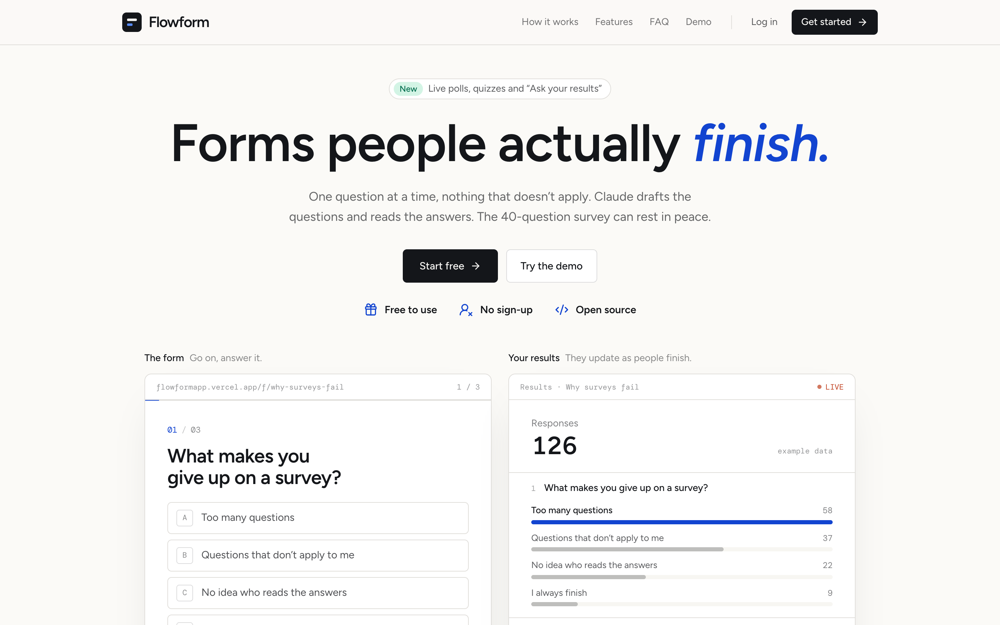

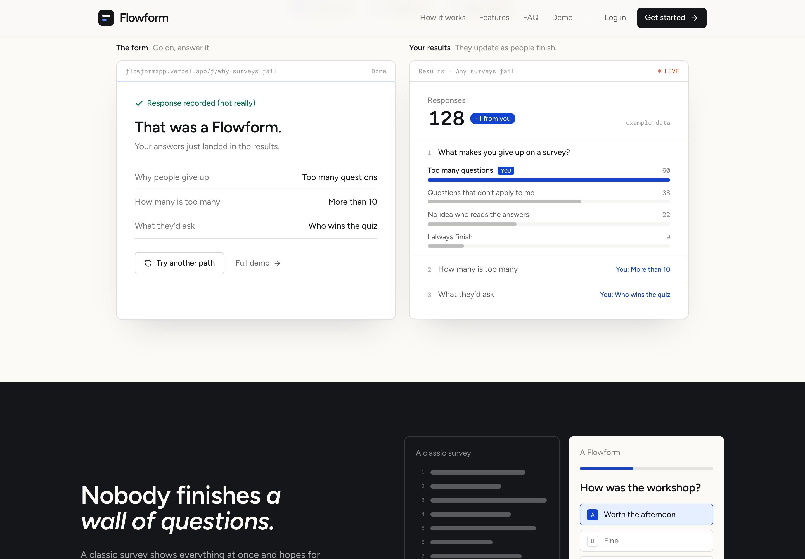

### The dashboard

Every signed-in page shares one sidebar. The dashboard leads with the workspace's numbers and
what to do next, then the forms themselves.

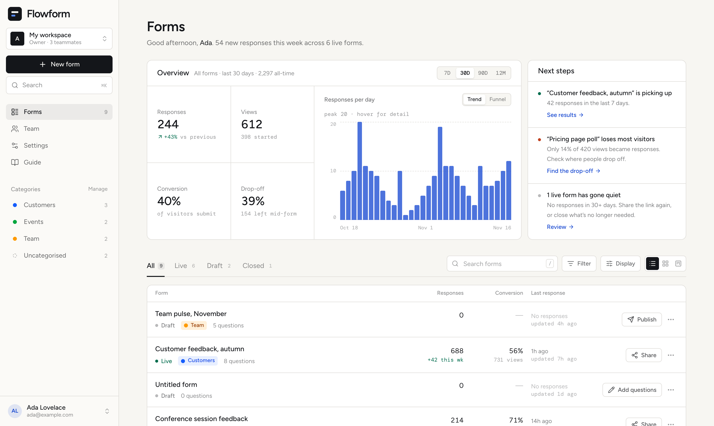

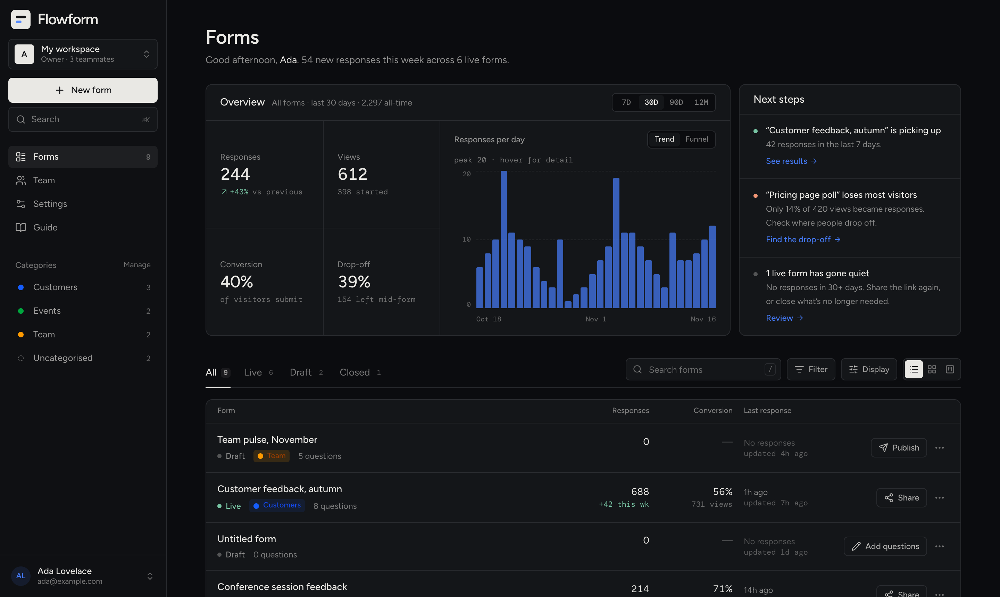

### Building a form

Questions are the main column; settings for the whole form sit beside them, and each question
ends in one row of its own options. This form has responses, so its questions are locked.

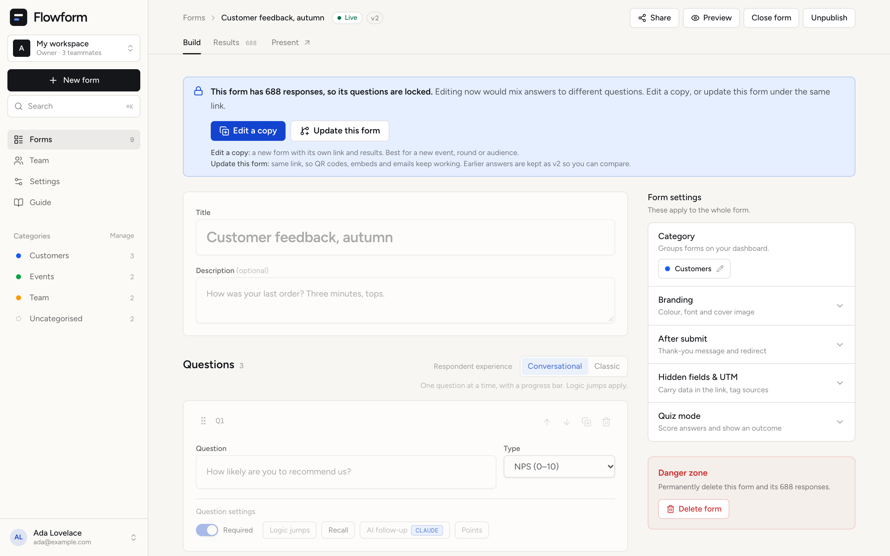

Claude's question drafts, real output for a form titled "Customer feedback survey". Nothing is
added until you click Add.

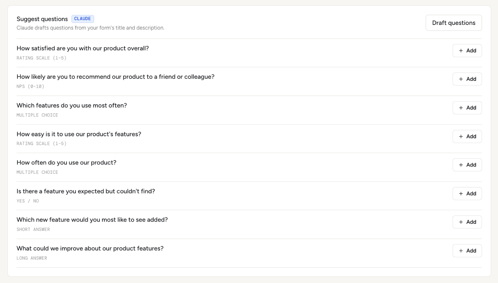

### Filling a form

One question at a time, set as a headline, with lettered options you can pick by keyboard.

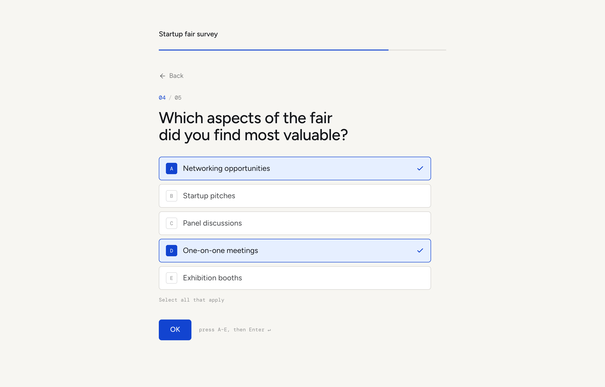

### Reading the results

Headline metrics, "Ask your results", and Claude's summary of the open answers with themes,
sentiment and quotes. It even flags placeholder test answers rather than reading meaning into
them.

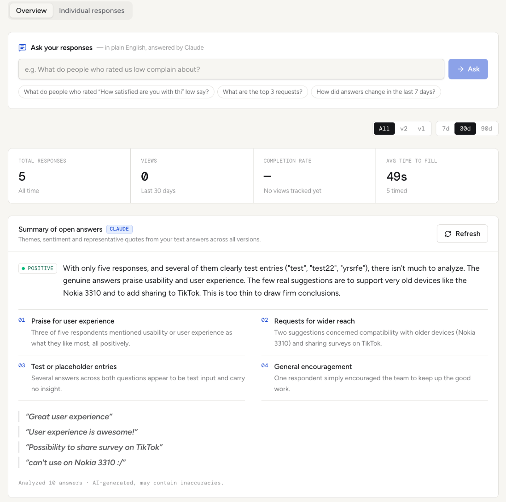

### Presenting live

The presenter view for talks and workshops: results update as answers arrive, and the room
joins with the QR code.

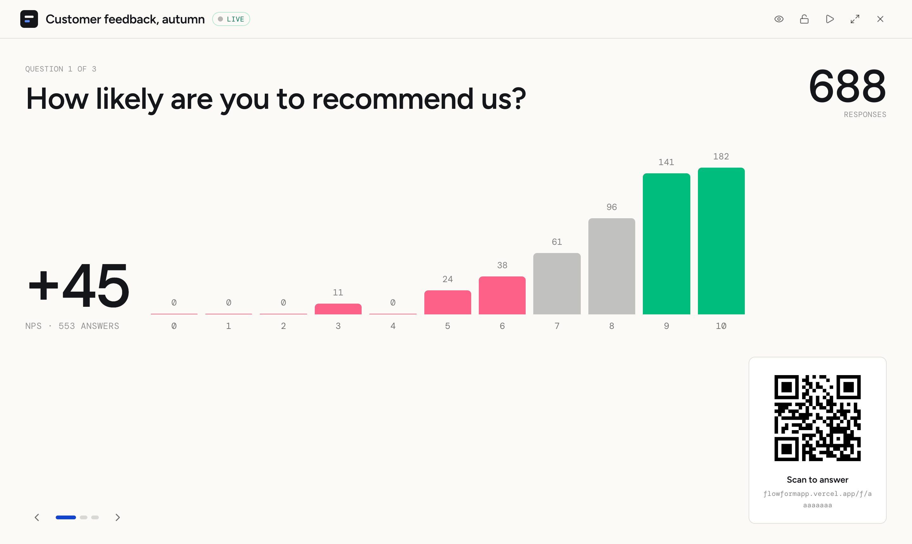

### The guide

Every feature, what it does, and where to find it.

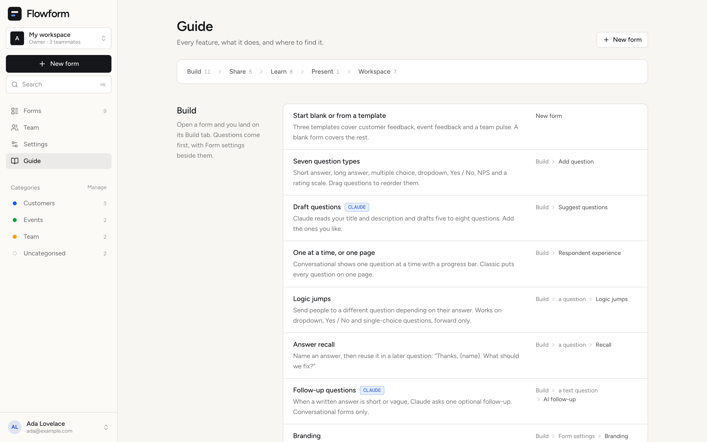

> Dashboard, editor, live and guide screenshots use demo data, rendered from the real app with a
> mocked backend; the AI and results screenshots come from the signed-in production app.

## How it evolved

From a purple Lovable prototype in May 2026 to today, in seven eras. Each one is a git tag you can
check out and run.

<a href="docs/EVOLUTION.md">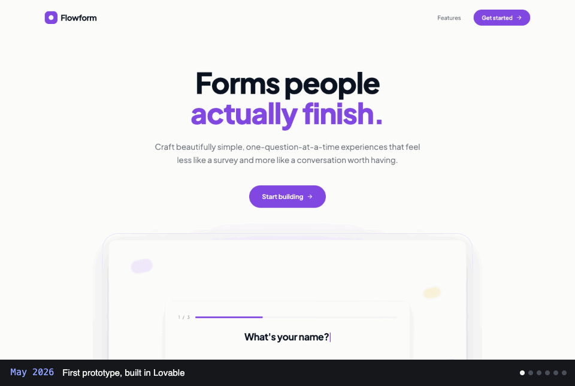</a>

| May 2026 | Jul 2026 | Nov 2026 |
| --- | --- | --- |
| 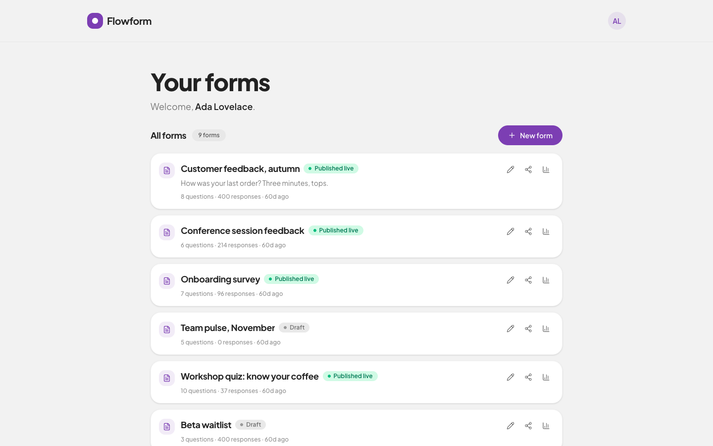 | 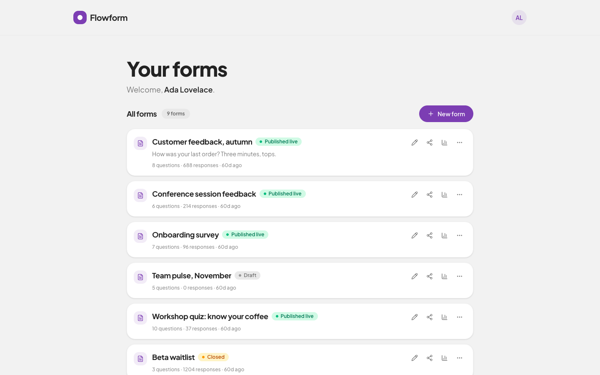 | 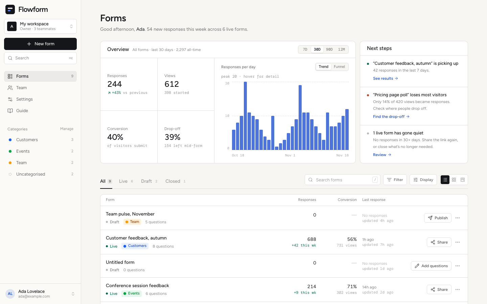 |

The full timeline, with what changed and why: [docs/EVOLUTION.md](docs/EVOLUTION.md).

## Design

The interface follows an editorial system rather than a SaaS template: near-black ink on warm
paper, a single accent colour, hairline rules instead of drop shadows, and type doing most of the
work.

| | Choice |
|---|---|
| **Type** | [Figtree](https://fonts.google.com/specimen/Figtree) throughout, an open, rounded sans chosen for readability: semibold for headlines and questions, regular for interface text, with [DM Mono](https://fonts.google.com/specimen/DM+Mono) for labels, counters and numbers |
| **Colour** | Ink `#14161A` on paper `#FBFAF7`, with one Klein-style blue (`#1244D0`) reserved for actions, selection, focus and live data. The landing page adds soft sky, sun, coral and mint tints behind its product demos |
| **Marks** | The logo is an ink tile with two "answer bars"; the Build / Branch / Learn / Present icons are drawn from the same shapes rather than a stock icon set |
| **Themes** | Every colour token has a dark value; the theme is applied before first paint, so there's no flash |
| **Voice** | One tone across every page: short, plain and exact, with at most one dry joke per screen and none on errors, legal pages or anything respondents see. Rules in [docs/voice.md](docs/voice.md) |
| **Shape** | Tight 6–8 px radii, 1 px hairline borders, one soft shadow for floating "product sheets" only |
| **Motion** | A single step transition between questions; respects `prefers-reduced-motion` |
| **Tokens** | All colours are `oklch` custom properties in [src/styles.css](src/styles.css), mapped to Tailwind utilities |

## How it's built

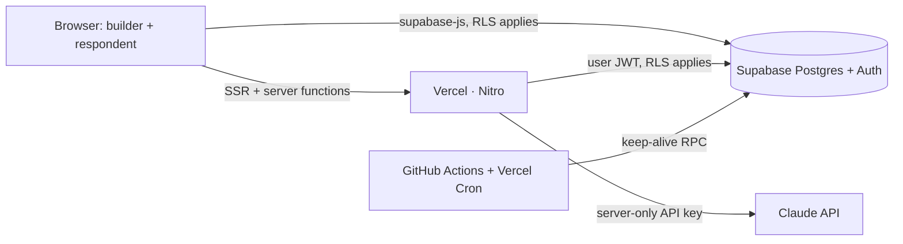

| Layer | Choices |
|---|---|
| **Frontend** | [TanStack Start](https://tanstack.com/start) (file-based routing, SSR), React 19, Tailwind CSS 4 with `oklch` design tokens, shadcn/ui on Radix primitives, dnd-kit for drag-and-drop, Recharts for analytics |
| **Backend** | TanStack Start server functions running as Vercel serverless functions via Nitro; Zod validation on AI input and output |
| **Database** | Supabase Postgres with row-level security on every table, 42 versioned SQL migrations, Realtime for the live view, transactional RPCs for editor saves and analytics, `CHECK` constraints on JSON shapes |
| **AI** | Anthropic Claude Sonnet 5.5 for question drafts, follow-up questions, open-text summaries and "Ask your results", called only from server functions, with refusal fallback and Zod-validated output; the public follow-up endpoint needs a single-use, rate-limited ticket |
| **Auth** | Supabase Auth: email verification with branded emails, password reset, email change, 10-minute idle auto-logout |
| **Automation** | Postgres trigger + `pg_net` posts a Slack alert on each confirmed signup (webhook URL kept in Vault); GitHub Actions runs CI; a keep-alive write runs from both GitHub Actions and Vercel Cron, and the workflow restores the project through the Management API if it was paused anyway |
| **Hosting** | Vercel, deployed from `main`; Bun for installs and scripts |

### Engineering highlights

- **RLS is the security boundary, not the client.** Every table has row-level-security policies
  scoped by workspace role (owner, admin, editor, viewer), public form filling is scoped by policy,
  and a pgTAP suite in CI checks each role's access. There is deliberately **no service-role key** in the app. The publishable key
  plus RLS does all the work, so a leaked client bundle grants nothing.
- **The Claude API key never reaches the client.** All four Claude features run in server
  functions and read the key from server-side env only. The public follow-up endpoint is guarded
  by a single-use, rate-limited ticket from the database, so it can't be used as a free Claude proxy.
- **Atomic editor saves.** Saving the builder is one transactional `save_form_editor` RPC that
  applies reorders, edits, inserts and deletes in a single round-trip, replacing an N+1 write path
  that could leave a form half-saved. Existing question IDs are preserved, so answers collected
  earlier (keyed by question ID) stay valid.
- **Analytics over all the data.** A `SECURITY DEFINER` RPC computes the funnel, trend and summary
  in Postgres across every response (not a client-capped sample), with ownership checked
  explicitly. The funnel is floored so it stays monotonic even when event tracking and response
  history don't line up.
- **Integrity enforced in the database.** `CHECK` constraints validate the `options` / `logic` JSON
  per question type. Submissions are rate-limited per IP and per form, and funnel events are
  de-duplicated and garbage-collected, all in SQL, so the rules hold no matter what hits the API.
- **Clean metrics.** The form owner's own test traffic is excluded from analytics, so the numbers
  reflect real respondents.
- **A demo workspace with no backend.** [`/explore`](https://flowformapp.vercel.app/explore) swaps
  the Supabase client's `fetch` for an in-browser stand-in ([src/lib/demo](src/lib/demo)) that
  speaks enough PostgREST and the app's RPCs to run the real signed-in UI on generated data. Edits
  persist in `sessionStorage` for the tab, Claude answers are pre-written, the live view simulates
  arrivals, and the stand-in is a lazy 11 KB (gzipped) chunk that only loads in the demo.
- **Security headers.** CSP `frame-ancestors`, HSTS, `nosniff`, a strict referrer policy and a
  locked-down permissions policy are set through Nitro route rules in [vite.config.ts](vite.config.ts).

## Run it yourself

You need [Bun](https://bun.sh), a [Supabase](https://supabase.com) project and an
[Anthropic API key](https://console.anthropic.com) (only for the AI features).

```bash
git clone https://github.com/andriuskleinas/flowform.git
cd flowform
bun install
cp .env.example .env   # fill in your own keys; never commit .env
bun run dev            # http://localhost:8080
```

Apply the SQL files in [`supabase/migrations/`](supabase/migrations) to your Supabase project, in
order (`supabase db push` with the Supabase CLI does this).

### Checks and tests

```bash
bun run lint         # eslint
bun run typecheck    # tsc --noEmit
bun run build        # production build
bun run test:db      # pgTAP: row-level security for owner / admin / editor / viewer / outsider / anon
bun run test:e2e     # Playwright: create → publish → respond → analyse
```

The two test suites run against a local Supabase stack (`supabase start`, needs Docker), never
production. For the end-to-end tests export `E2E_SUPABASE_URL`, `E2E_SUPABASE_ANON_KEY` and
`E2E_SUPABASE_SERVICE_ROLE_KEY` from `supabase status`.

[CI](.github/workflows/ci.yml) runs everything on every push and pull request: lint, typecheck and
build in one job; in another, a fresh Supabase stack replays every migration from scratch, then
the pgTAP suite and the Playwright suite run against it.

## Project layout

```
src/routes/                 file-based routes: landing, demo, auth, dashboard, guide, builder, fill, results, live
src/components/             app shell, form header, conversational form, question renderer, share dialog
src/components/ui/          shadcn/ui primitives
src/lib/                    server functions (Claude features), form logic, theme, CSV/PDF export
src/styles.css              design tokens (colour, type, radius) and base styles
src/integrations/supabase/  typed Supabase client
supabase/migrations/        schema, RLS policies, RPCs, constraints, triggers
supabase/tests/database/    pgTAP row-level-security tests
e2e/                        Playwright end-to-end tests
.github/workflows/          CI and Supabase keep-alive
docs/screenshots/           README screenshots
docs/voice.md               tone of voice
```

## License

[MIT](LICENSE) © Andrius Kleinas

---

<sub>Built by [Andrius Kleinas](https://github.com/andriuskleinas), designed and developed with [Claude Code](https://www.anthropic.com/claude-code) as an AI pair programmer.</sub>
